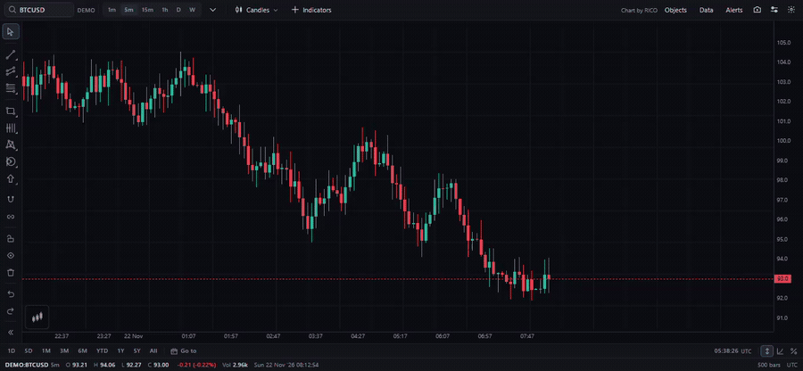

# RicoChart

**The AI-First Charting & Market Analysis Engine.**

  

Traditional charting platforms were built for human eyes and mouse clicks. Even with workarounds, AI agents struggle to use them properly because they weren't designed for AI from the ground up.

**RicoChart flips the model:** AI agents sit in the driver's seat—exploring charts, switching timeframes, running indicators, and drawing setups natively—while humans watch live as co-pilots, helpers, and decision-makers.

---

## Why RicoChart?

Today, when people try to make AI analyze charts, they hit two big walls:
1. **Screenshots are flat and blind to detail:** A single static screenshot gives shallow context, blurry price levels, and zero ability to explore. Real traders never trade by staring at one frozen picture.
2. **Raw number dumps hide the big picture:** Feeding thousands of rows of raw candle numbers into an AI makes it miss visual shapes, momentum curves, and clean market structure.

**RicoChart gives AI agents both eyes and hands on the chart—just like a real professional trader.**

---

## How AI "Sees" & Interacts in RicoChart

Instead of guessing from one static screenshot, RicoChart gives AI agents **3-Way Chart Vision + Full Interactive Controls**:

* **1. High-Res Smart Views (The Big Picture):** The AI controls its own camera—requesting crisp, clutter-free views of the chart (either completely clean/naked or with indicators and drawings turned on) whenever it wants to inspect overall shape and momentum.
* **2. Chart-Explained Structure (Live Market Facts):** The chart engine directly tells the AI what is happening on screen—trends, swing highs/lows, support & resistance zones, price gaps, wick rejections, and key levels.
* **3. Direct Raw Data (Exact Precision):** Instant access to exact candle prices (OHLCV), volume, and indicator values down to the last decimal—zero guessing on entries, stop-losses, or targets.
* **4. Interactive Exploration & "Draw-to-Verify":**
  * The AI actively flips timeframes (e.g., spotting a pattern on **4H**, marking the zone, then zooming into **15m** and **5m** to find an exact entry) and scrolls back through history.
  * When the AI draws a trendline, support box, or Fibonacci level, the chart engine instantly verifies it—reporting back exact touches, bounces, or candle breaks so the AI can check and refine its own work.

---

## Key Highlights

* **Agent-Led, Human-Friendly:** Every timeframe switch, indicator, and line the AI draws updates live on a clean visual chart so humans can watch, collaborate, or step in anytime.
* **Every Market in One Engine:** Built with plug-in data connectors to support **Crypto, Forex, Global Stocks, and Regional Exchanges** (including **Pakistan Stock Exchange — PSX**, **Korea Exchange — KRX**, and more).
* **Real Trader & Investor Tools:** Designed for everything real market participants rely on—multi-timeframe layouts, technical indicators, market structure, drawing tools, risk-reward rulers, bar replay, and smart alerts.

---

## Workspace Architecture (`v1.0.0`)

RicoChart is organized as a modular TypeScript monorepo (`packages/*`) on `main`:

| Package | Responsibility |
| :--- | :--- |
| **`packages/chart`** (`rico-chart`) | Zero-dependency Canvas & WebGL2 charting engine, drawing tools, transforms, orderflow profiles, widget shell, and workspace persistence. |
| **`packages/alerts`** (`@rico-chart/alerts`) | Event-driven alert & AI wake-up watchdog (edge-triggered price/zone/volatility/macro rules with cooldowns so AI sleeps at 0 tokens during quiet markets). |
| **`packages/execution`** (`@rico-chart/execution`) | **Pure-code deterministic execution engine** (zero AI allowed in execution path): order state machine, OCO bracket SL/TP, risk sizing, drawdown kill-switch, and blackout gates. |
| **`packages/backtest`** (`@rico-chart/backtest`) | Strictly **no-look-ahead** causal backtester (`SimulatedClock`, `PointInTimeFeed`, next-bar execution parity with `@rico-chart/execution`, performance metrics). |
| **`packages/paper-trading`** (`@rico-chart/paper-trading`) | Live paper trading engine driving `@rico-chart/execution` on streaming feeds with virtual balances, trade journal, and RicoChart order/P&L overlays. |
| **`packages/events`** (`@rico-chart/events`) | News Explorer and Macro/Big Events Calendar (FOMC meetings, CPI, NFP, central banks, earnings, pre/post blackout windows, and chart timeline markers). |
| **`packages/connectors`** (`@rico-chart/connectors`) | Unified plug-in market data connector registry for Crypto, Forex, Global Stocks, and regional exchanges (PSX, KRX). |

---

## Project Status

🚀 **v1.0.0** — Modular monorepo foundation live with core charting engine, event-driven alert watchdog, pure-code execution, no-look-ahead backtester, live paper trading, news & macro events, and market connectors.
